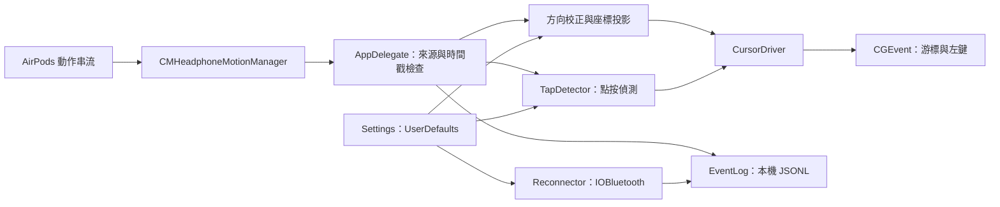

# 程式架構

[返回首頁](../README.md)

v0.1.0 使用 Swift 與 macOS 系統框架，主要程式位於 [`AirMouse/main.swift`](../AirMouse/main.swift)。AppKit 負責選單列與校正視窗，CoreMotion 讀取耳機資料，ApplicationServices 發送游標事件，IOBluetooth 處理重連，Carbon 註冊全域快捷鍵。沒有第三方套件依賴。

## 資料流

## 元件責任

| 元件 | 責任 |
| --- | --- |
| `V3` | 重力、角速度與校正軸的向量運算 |
| `Settings` | 速度、上下反轉、點按設定、左右耳方向與優先藍牙位址 |
| `EventLog` | 逐行寫入 JSON 事件；每行附牆鐘與 Unix 時間 |
| `CursorDriver` | 將角速度轉成平滑游標移動，發送滑鼠事件，處理點擊位置 |
| `Reconnector` | 在背景佇列查找已配對 AirPods 並嘗試連線 |
| `Calibrator` / `CalibrationPanel` | 引導靜止與抬起動作，建立每耳的前向軸 |
| `TapDetector` | 依加速度、角速度尖峰、背景晃動與靜止條件判斷點按 |
| `TapTestSession` / `TapTestAnalysis` / `TapTestPanel` | 收集提示式點按測試、重算門檻、顯示並套用結果 |
| `AppDelegate` | 整合權限、動作生命週期、選單、快捷鍵與統計 |

## 動作與方向

`CMHeadphoneMotionManager` 在主佇列送回 `CMDeviceMotion`。App 依 `sensorLocation` 區分來源耳；同一來源下，時間戳未遞增的樣本會被略過。來源改變時重設點按歷史，且檢查該耳是否需要方向校正。

校正先收集約 1.5 秒靜止重力，再整合「向上抬盒子前端」時的角速度，推算盒子前向軸，分耳保存。保存索引只有來源耳，未包含實體裝置識別，換一副耳機時需重新校正。使用時以即時重力取得向上軸，搭配保存的前向軸建立左右軸，再將角速度投影為 yaw、pitch、roll。Yaw 與 pitch 控制相對游標速度，roll 主要用於抑制手腕扭動造成的游標偏移。

串流開始的前 0.3 秒會略過一般游標處理。沒有有效校正或軸方向時停止移動。程式用持續到達的新樣本判斷資料狀態，`isDeviceMotionAvailable` 與連線通知本身不足以證明串流正常。

## 游標與點按

`CursorDriver` 以名目 120 Hz 計時器整合游標位移；這是排程目標，實際回呼頻率受系統負載影響。角速度先經死區、速度增益、加速與平滑處理。距離上次動作輸入超過 0.15 秒，或收到停止控制／斷線指令時，會清除移動速度。螢幕邊界取自有效顯示器列表。

`TapDetector` 同時觀察加速度與角速度的短暫尖峰，要求前置樣本較平靜，並以近期晃動提高有效門檻。低於 0.30 g 的細微點按需要額外靜止條件，雙擊的第二下有例外；0.14 秒不應期用於排除回彈。這些數字是實作規則，未代表跨裝置精準度保證。

點按被允許時，游標回到近期記錄的位置並送出左鍵按下／放開事件。雙擊次數依位置距離及 macOS 的雙擊時間判定。程式內有通用滑鼠按鈕發送函式，v0.1.0 的操作路徑只使用左鍵。移動事件可延續系統已存在的左鍵按住狀態，但 App 沒有獨立啟動或結束拖放的手勢。

點按校正測試在記憶體中保存該輪角速度與加速度，用同一偵測器重算 0.06–0.50 g 的候選門檻。評分依序加重誤觸與多算的成本，再考慮漏判，最後由使用者按「套用」保存建議值。現行分析未完整驗證每個階段的樣本覆蓋率，串流中斷後仍可能產生建議；結果也未驗證 OS 或目標 App 的雙擊接收情形。測試中有中斷應重做整輪。

## 連線與生命週期

每秒檢查權限、資料新鮮度與動作服務狀態。已授權且服務未啟動時可重新訂閱；已連線但資料超過 4 秒未更新時，也會在節流條件下重啟動作串流。

自動藍牙重連需同時符合：動作權限未被拒絕或限制、超過 4 秒沒有新資料、動作服務未連線、游標控制開啟，以及自動重連設定開啟。候選為已配對且名稱含 `AirPods` 的裝置，優先使用已保存位址，否則選最近存取者。`openConnection()` 在獨立佇列執行；失敗會拉長重試間隔，連續失敗超過 10 次後每 60 秒重試。連線成功與恢復新動作樣本為分開的狀態。

暫停游標控制不會停止 CoreMotion 訂閱與記錄，也不會撤銷已送出的藍牙請求。結束 App 時停止動作更新、解除快捷鍵並寫入 `session_end`。睡眠喚醒後會嘗試重啟串流；該恢復路徑仍需更多實機驗證。

重複啟動時，以 bundle identifier 尋找既有程序，再使用本機分散式通知請它顯示方向校正或點按測試，新程序隨後結束。

## 保存與診斷

UserDefaults 網域為 `local.winston.airpods-air-mouse`。JSONL 預設記錄連線、設定、校正、點按與每 10 秒一次的統計；`--raw` 額外記錄部分處理路徑上的逐筆角速度、重力與加速度。

選單「有資料」比例使用「該秒至少收到一筆樣本」的秒數估算，無法代表每秒都維持完整頻率。中斷次數與最長間隔是在資料恢復時更新，工作階段結尾尚未恢復的中斷可能未納入。評估連線可靠性時應結合記錄時間線與實際操作條件。

記錄寫入失敗目前沒有完整的使用者錯誤提示；選擇自訂資料夾時應確認可寫入。App 不含自動更新、遠端服務或記錄上傳。資料欄位與清除方式見[隱私說明](privacy.md)。

## 建置與驗證邊界

[`AirMouse/build.sh`](../AirMouse/build.sh) 建置 macOS app bundle；[`scripts/check.sh`](../scripts/check.sh) 與 [`scripts/package.sh`](../scripts/package.sh) 提供檢查與發佈封裝。Bundle identifier 與 executable 保留為 `local.winston.airpods-air-mouse`、`AirPodsAirMouse`，顯示名稱為 Air Mouse。

自動檢查可以確認原始碼、產物與封裝一致性。方向、點按、藍牙交接與斷線恢復仍需 AirPods、macOS 權限及真人操作驗證。已完成與待補的範圍見[驗證說明](verification.md)。
