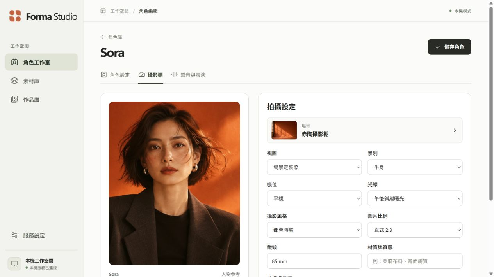
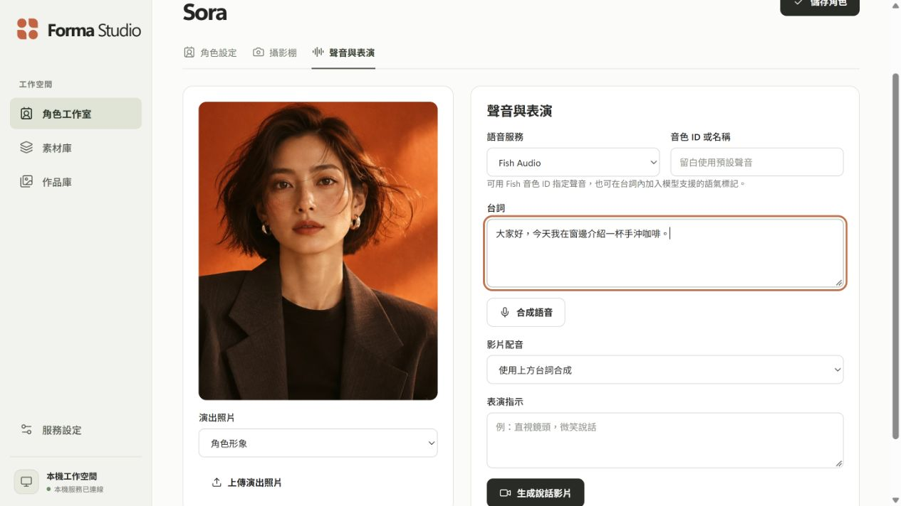
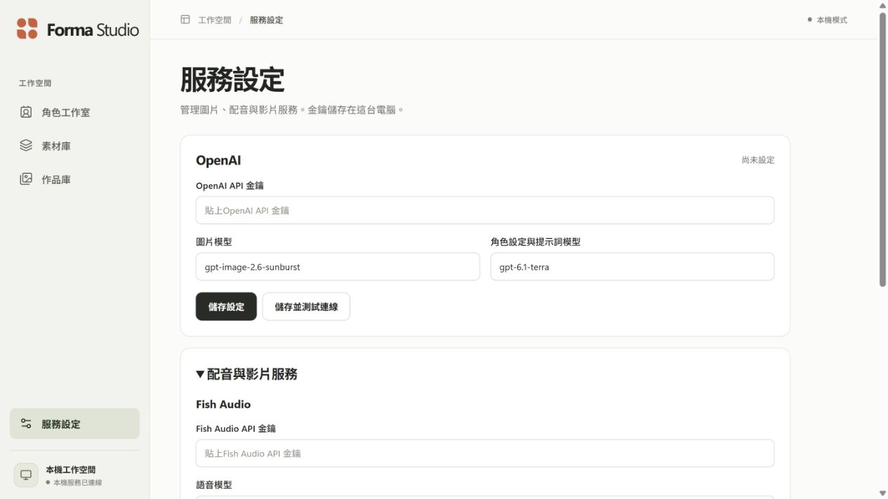

# W47｜Forma Studio 數位人訂製工作室

用本機介面建立可重複使用的虛構角色：保存人物設定與參考圖，在攝影棚調整場景、鏡位與光線，再用 OpenAI 生成定裝照、用 Fish Audio 合成配音。也可在作品庫管理圖片、配音與任務狀態。

1. 完整解壓教材 ZIP，保留資料夾結構。
2. 在本機 Codex 開啟解壓資料夾，把 [給 Codex 的啟動任務](starter/給-Codex-的啟動任務.md) 貼給它。
3. 由你本人在工作室的「服務設定」輸入自己的 OpenAI、Fish Audio 金鑰。請勿將金鑰貼到聊天或提交到 Git。

手動操作可直接看 [安裝與啟動](completed/forma-studio/README.md)。接著完成 [60 分鐘練習](lesson.md)，有問題先看 [排除步驟](docs/troubleshooting.md)。

**Preview 範圍：** 解壓包內含工作室、原創角色範本與場景。OpenAI 與 Fish Audio 需要自己的帳號、對應模型的權限、額度與網路；影片生成另需 LongCat／Colab，不在兩組 API 金鑰的基本路徑內。所有外部生成先確認費用與素材授權，詳見[資料與使用權](docs/privacy-and-content-rights.md)及[驗證範圍](docs/verification.md)。

## 操作畫面

以下為學員版介面，以隔離的虛構示範資料擷取。角色庫的額外一筆是示範資料；新安裝起始為五個範本。畫面未使用真實金鑰，未送出生成。

**角色工作室｜** 從內建虛構範本選一個開工。

**攝影棚｜** 在同一角色上改場景、視圖、景別、鏡位與光線。

**聲音與表演｜** 選 Fish Audio、輸入台詞與選用音色。語音與影片是分開的操作。

**服務設定｜** 兩組金鑰各自在本機介面填入並儲存。

